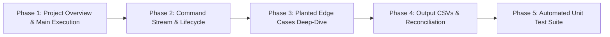

# Oral Defense & Live Demonstration Script
## Tour Package Pricing & Itinerary Cost Engine (PS-046 / Team T017)

This script is designed for the student presenter conducting the capstone evaluation and viva voce defense. It provides a structured, step-by-step walkthrough of the system architecture, live code execution, edge-case demonstrations, output artifact validation, and examiner Q&A.

---

## Presentation Metadata & Overview

- **Project Title:** Tour Package Pricing and Itinerary Cost Engine
- **Target Audience:** Academic Evaluators, External Examiners, Industry Assessors
- **Allocated Time:** 10–15 Minutes (Demo + Q&A)
- **Primary Execution Commands:**
  - `python main.py`
  - `python -m unittest tests.test_engine -v`

---

## Pre-Demo Setup Checklist (1 Minute Before Evaluator Arrives)

1. Open PowerShell or Terminal in the project root directory:
   ```powershell
   cd c:\Users\Admin\10sec_capstone_project
   ```
2. Verify Python version is 3.10 or higher:
   ```powershell
   python --version
   ```
3. Verify test suite passes cleanly:
   ```powershell
   python -m unittest tests.test_engine -v
   ```
   *(Ensure output shows `Ran 18 tests ... OK`)*
4. Ensure files in `outputs/` are ready for inspection.

---

## 5-Phase Live Demonstration Flow



---

### Phase 1: High-Level Pitch & System Architecture (2 Minutes)

#### What to Say to the Examiners:
> "Good morning, respected evaluators. Our project, **Team T017**, addresses **Problem Statement PS-046: Tour Package Pricing and Itinerary Cost Engine with Seasonality, Group Discounts, and Child Policies**."
> 
> "In commercial tourism, quoting a customized tour is fraught with margin risk. A single quote must harmonize hotel seasonal rates, vehicle capacities, child age limits, opt-outs, group discounts, and foreign exchange hedging. Furthermore, when clients add or drop members, change travel dates, or cancel, traditional systems either require cumbersome manual recalculations or cause financial leakage."
> 
> "We engineered an automated, deterministic pricing engine in pure Python 3.10+ using `Decimal` arithmetic. It ingests 11 relational datasets, executes transactional lifecycle commands, maintains an immutable version history, and guarantees exact mathematical reconciliation down to the paisa between macro quote summaries and itemized customer invoices."

---

### Phase 2: Live Execution of `main.py` (2 Minutes)

#### Action:
Run the main application from your terminal:
```powershell
python main.py
```

#### What to Highlight on the Screen:
1. **Four-Step Execution Pipeline:**
   - `[Step 1/4] Loading relational datasets...` (Shows 11 CSV files loaded into indexed memory).
   - `[Step 2/4] Parsing commands.txt...` (Shows 106 commands extracted, ignoring comments).
   - `[Step 3/4] Executing command stream...` (Processes batch quotes, date shifts, additions, removals, cancellations).
   - `[Step 4/4] Exporting output CSV files...` (Generates `cost_sheet.csv`, `quote_summary.csv`, `traveller_invoice.csv`, `change_log.csv`).
2. **Terminal Visual Outputs:**
   - Point out the formatted ASCII tables for `PRINT_COST_SHEET` and `PRINT_INVOICE`.
   - Explain how `Q-029` and `Q-030` show day-by-day supplier costs, applied discounts, GST, and individual traveller breakdowns.
3. **Execution Summary:**
   - 30 Unique Quotes managed.
   - 44 Quote Versions priced.
   - 16 Change Log entries generated.
   - 216 Invoiced Travellers processed.

---

### Phase 3: Planted Edge Cases Deep-Dive (4 Minutes)

*Examiners will specifically look for how edge cases are handled. Walk through these 5 key scenarios:*

#### 1. EC-01: Child Age Gating & Child-Minding Fee (`Q-010`)
- **Location in Code:** `src/itinerary_engine.py` & `src/cost_engine.py`
- **Scenario:** Family of 4 on PKG-01 (Kerala). Child `TRV-0062` is 4 years old.
- **Rules Demonstrated:**
  - `TRV-0062` is under 5: Stays free in parents' room (Rs 0 room cost), sits on parents' lap (Rs 0 vehicle cost), and eats free (Rs 0 meal cost).
  - On Day 1 (`ACT-01`, Spice Plantation, min age 5) and Day 3 (`ACT-03`, Bamboo Rafting, min age 10), the 4-year-old is disqualified.
  - Because **both parents participate**, the engine automatically assigns a supervisory **Child-Minding Fee of Rs 500 per activity**, charging Rs 1,000 total to the child's invoice.

#### 2. EC-02: Group Leader Free-of-Charge (FOC) & Cost Redistribution (`Q-027`)
- **Location in Code:** `src/cost_engine.py` (`_calculate_traveller_invoices`)
- **Scenario:** 16 adult travellers on PKG-02 (Golden Triangle). Leader `TRV-0186` is designated organizer.
- **Rules Demonstrated:**
  - Exactly 15 paying adults + 1 leader qualifies for the **1 FOC incentive**.
  - In `traveller_invoice.csv`, `TRV-0186` has **Rs 0.00** across all columns.
  - The leader's actual room, transport, guide, meal, and activity costs are distributed equally across the 15 paying adults.
  - **Reconciliation:** Sum of all 16 invoices matches `quote_summary.csv` total sell price to the exact paisa!

#### 3. EC-03: Combined Discount Cap (`Q-019`)
- **Location in Code:** `src/pricing_engine.py` (`calculate_applied_discounts`)
- **Scenario:** 12 paying adults booked 60+ days in advance.
- **Rules Demonstrated:**
  - Group size 12 qualifies for a **10% Group Discount**.
  - Lead time $\ge 60$ days qualifies for an **8% Early-Bird Discount**.
  - Nominal total = 18%.
  - The engine enforces the company policy ceiling: **strictly capped at 15.0%**.

#### 4. EC-06: Group Size Reduction Dropping Discount Tier (`Q-026`)
- **Location in Code:** `src/quote_manager.py` (`_handle_remove_traveller`)
- **Scenario:** Quote `Q-026` originally has 10 adults (qualifying for the 10% group discount tier). At 30 days prior to departure, `TRV-0185` cancels.
- **Rules Demonstrated:**
  - The group drops from 10 to 9 paying adults, dropping the discount from **10% to 5%**.
  - The engine assesses a **25% cancellation penalty** on the departing traveller (30-day window).
  - Version `v2` is generated with re-priced invoices for the remaining 9 travellers.

#### 5. FX Risk Hedging & Rate Locking (`Q-025`)
- **Location in Code:** `src/quote_manager.py` & `src/cost_engine.py`
- **Scenario:** Dubai package (PKG-03) priced in USD.
- **Rules Demonstrated:**
  - Base USD exchange rate on quote date: Rs 84.76.
  - Engine applies mandatory **2% buffer**: $\text{Effective Rate} = 84.76 \times 1.02 = \text{Rs } 86.4552$.
  - When a subsequent `ROOM_CHANGE` command executes, the engine does **not** re-fetch the new day's exchange rate; it retains the **locked FX rate** from `v1`.

---

### Phase 4: Verification of Generated CSV Files (2 Minutes)

Open or display the generated files in `outputs/` (and root `.`):

```powershell
Get-ChildItem outputs
```

1. **`outputs/cost_sheet.csv`** (833 rows)
   - Show columns: `quote_id,version,day,component_type,component_id,season,season_multiplier,unit_cost_inr,units,total_cost_inr`.
   - Explain how every night resolves against `season_calendar.csv` (e.g., Shoulder 1.2x vs Peak 1.5x in `Q-017`).
2. **`outputs/quote_summary.csv`** (46 rows)
   - Show how version evolution is tracked (`v1`, `v2`, `v3`).
   - Highlight columns: `net_cost, markup_amount (+18%), group_discount_pct, early_bird_discount_pct, applied_discount_pct, discount_amount, gst_amount (+5%), total_sell_price`.
3. **`outputs/traveller_invoice.csv`** (218 rows)
   - Show columns: `quote_id,version,traveller_id,name,age_on_departure,pricing_category,room_cost,shared_cost,activity_cost,meal_cost,child_minding_cost,pre_gst_total,gst_amount,total_amount`.
   - Demonstrate FOC rows having `0.00` and paying adults carrying equitable shares.
4. **`outputs/change_log.csv`** (18 rows)
   - Show audit trail: `from_version,to_version,change_type,change_fee,cancellation_fee,cost_difference,description`.
   - Show date-shift fees (Rs 1,000/traveller for $\le 7$ days in `Q-001`) vs cancellation penalties ($> 7$ days in `Q-002`).

---

### Phase 5: Automated Test Suite Execution (2 Minutes)

#### Action:
Run the test suite in verbose mode:
```powershell
python -m unittest tests.test_engine -v
```

#### What to Say:
> "To guarantee production reliability, we built an automated regression test suite with 18 comprehensive tests. It covers all 8 planted edge cases, schema validations, cancellation boundaries, duplicate command rejection, and exact mathematical invoice reconciliation."
> 
> "As you can see on screen, all 18 test cases pass in under 0.2 seconds with zero failures."

---

## Examiner Q&A Cheat Sheet (Anticipated Viva Questions)

### Q1: Why did you choose Python's `Decimal` module instead of standard `float`?
**Answer:**  
Standard IEEE 754 floating-point arithmetic introduces binary rounding errors (such as `0.1 + 0.2 = 0.30000000000000004`). In financial accounting and tour invoicing, cumulative rounding drifts across thousands of room nights and taxes can result in discrepancies between quote summaries and customer invoices. Using `Decimal` with explicit `ROUND_HALF_UP` guarantees exact arithmetic down to 2 decimal places.

### Q2: How does your engine calculate child age if a child has a birthday during the tour?
**Answer:**  
We deliberately split age evaluation into two contexts:
1. **Invoice Pricing Category:** Evaluated on the tour departure date (e.g., `CHILD_5_11`). This is displayed on the invoice.
2. **Component Service Eligibility:** Evaluated on the exact calendar date of the service. For instance, in `Q-009`, if a child turns 12 during the trip, their meal or activity eligibility on that day uses their completed age on that specific date.

### Q3: How is the FOC (Free of Charge) leader handled without eating into operator margins?
**Answer:**  
When a group qualifies (15+ paying adults + 1 leader in `Q-027`), the leader's invoice is set to Rs 0.00. However, the supplier costs incurred by the leader (hotel bed, transport seat, guide service, meals) are treated as part of the group's total net package cost. In `cost_engine.py`, the leader's costs are redistributed equally across the 15 paying adult invoices. Thus, the operator retains their full 18% markup and the quote reconciles perfectly.

### Q4: How do you handle an odd number of adults in room allocation?
**Answer:**  
If there are 5 adults, 4 occupy 2 double rooms. For the 5th adult:
- If the policy is `SINGLE`, we allocate a single room charged with a 1.6x single supplement multiplier.
- If the policy is `TRIPLE`, the 5th adult is placed as a third person in a double room with a 25% discount on the per-person rate (effective multiplier 1.75x for that room).

### Q5: What is the difference between a date shift $\le 7$ days versus $> 7$ days?
**Answer:**  
- **$\le 7$ Days:** Treated as a booking amendment. We assess a change fee of Rs 1,000 per traveller and reprice the itinerary for any seasonal tariff changes.
- **$> 7$ Days:** Treated as a cancellation and new booking. We apply a cancellation penalty on the old booking based on days remaining to the original departure date, and issue a fresh quote for the new date.

### Q6: How does the engine hedge against foreign currency fluctuations?
**Answer:**  
For packages priced in foreign currencies (e.g., Dubai in USD), we ingest the exchange rate on the quote date and apply a mandatory 2% buffer (`FX_BUFFER_PCT = 2`). Crucially, this effective rate is **locked** in the quote version. If the customer subsequently requests a room change or date shift, the engine retains the locked exchange rate, protecting the customer from exchange spikes and the agency from margin erosion.

---

## Emergency Fallback & Troubleshooting Guide

If the examiner asks you to clear all outputs and regenerate from scratch:
```powershell
# 1. Clean outputs
Remove-Item outputs\*.csv -Force

# 2. Re-run main
python main.py

# 3. Re-verify
python -m unittest tests.test_engine -v
```
Everything will regenerate cleanly in under 2 seconds.
