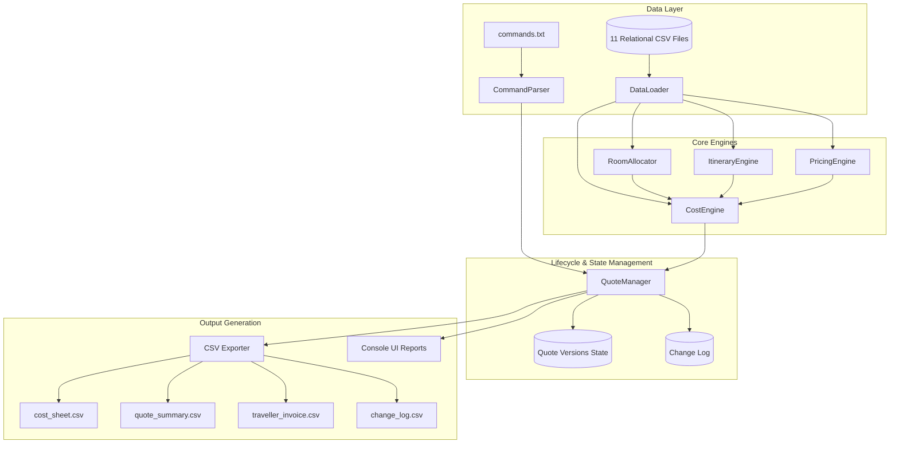

# Capstone Project Report
## Tour Package Pricing & Itinerary Cost Engine
### With Seasonality, Group Discounts, Child Policies, and Quote Lifecycle Management

---

**Project Title:** Tour Package Pricing and Itinerary Cost Engine  
**Problem Statement ID:** PS-046  
**Team ID:** T017  
**Academic Level:** Senior Undergraduate Capstone Project (B.Tech Computer Science & Engineering)  
**Implementation Language:** Python 3.10+  
**Operating System:** Cross-Platform (Windows / Linux / macOS)  

---

## Executive Summary / Abstract

The modern travel and tour operations industry requires dynamic, precise, and transparent pricing systems capable of managing complex, interdependent constraints. Unlike static e-commerce pricing, package tours encompass multi-day itineraries, fluctuating seasonal tariffs, heterogeneous accommodation capacities, vehicle seating constraints, age-gated activity policies, foreign exchange volatility, and evolving customer requests (such as date shifts, group additions/removals, and room preference changes).

This project implements a robust, modular, and enterprise-ready **Tour Package Pricing and Itinerary Cost Engine** in pure Python 3.10+. The engine ingests relational configuration data across 11 CSV datasets (hotels, vehicles, meals, activities, itineraries, seasonality calendars, rate parameters, and daily foreign exchange rates) and executes transactional quote streams from a command specification file. 

Key architectural highlights include:
1. **Capacity-Constrained Accommodation Packing:** Handles adult room distribution, odd-adult room policies (`SINGLE` supplement at 1.6x vs `TRIPLE` occupancy), child extra beds (40% surcharge for children 5–11), and infants (<5 years) staying free with parents.
2. **Age-Tiered Child Policies & Child-Minding:** Implements age evaluation on the exact date of service delivery for activities and accommodation, distinct from departure age invoicing. Automatically triggers a Rs 500 child-minding fee when both parents participate in an age-ineligible activity.
3. **Equitable Shared-Component Apportionment:** Shared assets (vehicles and licensed guides) are apportioned such that children aged 5–11 pay exactly 50% of an adult share, infants pay Rs 0, and FOC (Free of Charge) group leader costs are equitably absorbed by paying travellers.
4. **Group Leader FOC Incentive & Cost Redistribution:** For qualifying groups (15+ paying adults + designated group leader), the leader's invoice is zeroed out, and their actual room, shared, activity, and meal costs are redistributed among paying adults, preserving exact financial reconciliation.
5. **Locked Foreign Exchange Hedging:** Currency conversions for overseas itineraries (e.g., Dubai in USD) lock in the quote creation date exchange rate plus a 2% hedging buffer across the entire lifecycle, protecting margins against currency fluctuations.
6. **Immutable Quote Lifecycle Versioning:** Complete lifecycle management (`QUOTE`, `ADD_TRAVELLER`, `REMOVE_TRAVELLER`, `DATE_SHIFT`, `ROOM_CHANGE`, `CANCEL`) maintaining immutable quote version histories, detailed change logs, cancellation penalty tiers, and exact four-file CSV exports.

The entire engine has been rigorously verified against 18 comprehensive automated unit and integration tests, successfully handling all planted edge cases (EC-01 through EC-08) with zero runtime dependencies beyond Python's standard library.

---

## 1. Introduction and Background

In bespoke and group tour operations, quotation generation is notoriously prone to manual error. Pricing managers frequently struggle with:
- **Seasonality Mismatches:** A tour spanning shoulder and peak dates requiring day-by-day multiplier resolution.
- **Sub-optimal Room Allocation:** Inability to optimize room configurations when group numbers are odd, leading to unexpected single supplement losses or overcrowding.
- **Complex Child Rules:** Inaccurate charging of children across shared versus fixed components, and failure to provide child-care when parents attend restricted activities.
- **Dynamic Group Changes:** Inability to track changes over time, recalculate tiered group discounts upon traveller cancellations, and assess date-shift fees accurately.
- **Currency Fluctuations:** Unhedged foreign currency conversion leading to margin erosion between quote date and tour departure.

The objective of this capstone project is to engineer an automated, deterministic, and auditable pricing engine that eliminates human error, guarantees exact accounting reconciliation down to the paisa (using Python's `Decimal` module), and provides an auditable paper trail across all quote lifecycle modifications.

---

## 2. Problem Statement & Scope

### 2.1 Problem Statement (PS-046)
Develop an end-to-end pricing and itinerary cost calculation engine for customized multi-day tour packages that:
1. Models realistic supply-side supplier costs (hotels, meals, vehicles, guides, activities) across multiple domestic and international destinations (Kerala, Golden Triangle, Dubai).
2. Applies dynamic commercial rules (seasonality multipliers, early-bird discounts, tiered group volume discounts, profit markups, and Goods and Services Tax).
3. Adheres strictly to hospitality child policies, including extra bed pricing, activity age gating, and supervisory child-minding fees.
4. Manages full quote lifecycle transitions through an external command stream, producing audit change logs and version histories.
5. Exports four standardized reporting CSV files with strict column ordering and formats:
   - `cost_sheet.csv`: Granular day-by-day and component-by-component supplier cost breakdowns.
   - `quote_summary.csv`: Macro-level quote versions, total cost, markup, discounts, GST, and final sell prices.
   - `traveller_invoice.csv`: Individual itemized traveller billing breakdowns reconciling perfectly with the quote summary.
   - `change_log.csv`: Transactional audit log recording every quote lifecycle transition, fee, and delta.

### 2.2 System Scope
The system operates as a command-line application designed for travel agency back-office operations, enterprise tour aggregators, and academic evaluation. It processes batch command streams, generates real-time console summaries, and exports audit-ready CSV artifacts.

---

## 3. System Architecture & Design

### 3.1 Architectural Diagram
The engine is structured as a layered, modular pipeline adhering to clean architecture principles:



### 3.2 Data Flow Pipeline
1. **Ingestion & Validation:** `DataLoader` loads and validates 11 input CSV files into indexed dictionaries using appropriate numeric types (`Decimal` for currency, `datetime.date` for dates).
2. **Command Parsing:** `CommandParser` parses the linear execution stream in `commands.txt`, validating command syntax, parameter counts, and data types.
3. **Execution & Allocation:** For each quote or lifecycle action:
   - `RoomAllocator` determines room counts, extra beds, and single/triple arrangements.
   - `ItineraryEngine` expands package day plans, evaluates seasonal dates, checks activity eligibility, and resolves opt-outs and child-minding.
   - `PricingEngine` identifies applicable vehicles, guide tiers, seasonal multipliers, and discount structures.
   - `CostEngine` calculates net supplier costs, applies commercial markup (+18%), calculates discounts, adds GST (+5%), and computes individual traveller invoices.
4. **State & Versioning:** `QuoteManager` manages quote state transitions, creates immutable version snapshots (`v1`, `v2`, etc.), records change log entries, and computes cancellation or date-shift fees.
5. **Export & Reconciliation:** Four standardized CSV outputs are generated in both `outputs/` and project root `.`, verifying exact reconciliation between invoice aggregates and quote totals.

---

## 4. Technology Stack & Design Decisions

| Component | Technology | Rationale |
|---|---|---|
| **Programming Language** | Python 3.10+ | Clean syntax, native type hinting, standard library dataclasses, robust cross-platform execution. |
| **Monetary Arithmetic** | `decimal.Decimal` | Avoids floating-point rounding anomalies (e.g., `0.1 + 0.2 != 0.3`). Ensures exact currency math rounded to two decimal places (`ROUND_HALF_UP`). |
| **Date Handling** | `datetime.date`, `datetime.timedelta` | Precision calendar calculations, day-interval evaluation, leap year compliance, and exact age-at-service determination. |
| **Data Ingestion/Export** | Python `csv` module | Standardized RFC 4180 CSV handling with explicit newline and quoting controls; zero third-party dependencies. |
| **Testing Framework** | `unittest` | Native standard library test runner enabling portable execution across CI/CD and academic evaluation environments without installing virtual environments. |

---

## 5. Detailed Module Specifications

### 5.1 `src/data_loader.py`
- **Role:** Central data ingestion gateway.
- **Responsibilities:**
  - Loads 11 relational CSV files: `hotels.csv`, `activities.csv`, `vehicles.csv`, `meals.csv`, `rate_parameters.csv`, `season_calendar.csv`, `fx_rates.csv`, `packages.csv`, `package_itinerary.csv`, `travellers.csv`, `activity_optouts.csv`.
  - Converts currency fields to `Decimal` and date strings (`YYYY-MM-DD`) to `datetime.date`.
  - Indexes itineraries by `package_id` and day sequence, and travellers by `quote_id` and `traveller_id`.

### 5.2 `src/command_parser.py`
- **Role:** Domain-specific command interpreter.
- **Responsibilities:**
  - Reads `commands.txt` ignoring blank lines and comments (`#`).
  - Identifies 8 command verbs: `QUOTE`, `ADD_TRAVELLER`, `REMOVE_TRAVELLER`, `DATE_SHIFT`, `ROOM_CHANGE`, `CANCEL`, `PRINT_COST_SHEET`, `PRINT_INVOICE`.
  - Performs syntax validation, extracting quote IDs, dates, room types, and traveller IDs into structured command dictionaries.

### 5.3 `src/room_allocator.py`
- **Role:** Accommodation inventory optimization.
- **Responsibilities:**
  - Groups travellers into adults (age $\ge 12$), children aged 5–11, and infants under 5.
  - Determines double rooms: $\lfloor N_{\text{adults}} / 2 \rfloor$.
  - Handles odd adult count ($N_{\text{adults}} \pmod 2 == 1$):
    - `SINGLE`: Allocates 1 single room charged at 1.6x of the double room rate ($1.0 + \text{single supplement of } 0.6$).
    - `TRIPLE`: Places the odd adult as a third person in a double room at a 25% discount on the per-person rate (multiplier $1.0 + 0.75 = 1.75$ for the room).
  - Child Extra Beds: Children aged 5–11 receive an extra bed in parent rooms at 40% of the base double room rate.
  - Infants (<5): Stay free of charge sharing existing bedding with two adults.

### 5.4 `src/pricing_engine.py`
- **Role:** Commercial rules and tariff calculation.
- **Responsibilities:**
  - **Season Multiplier:** Resolves night dates against `season_calendar.csv`: Peak (1.5x), High (1.3x), Shoulder (1.2x), Lean (1.0x).
  - **Vehicle Allocation:** Selects smallest vehicle capable of carrying all seated passengers:
    - Sedan (1–3 passengers): Rs 3,500/day
    - SUV (4–6 passengers): Rs 5,000/day
    - Tempo Traveller (7–12 passengers): Rs 8,500/day
    - Mini Bus (13–20 passengers): Rs 14,000/day
    - Infants under 5 are unseated and do not count toward vehicle capacity.
  - **Guide Tariff:** 1–6 travellers = Rs 2,500/day; 7+ travellers = Rs 4,000/day. Infants are excluded.
  - **Group Discounts:** 5–9 paying travellers: 5%; 10–14: 10%; 15+: 15%.
  - **Early Bird Discount:** Quote date $\ge 60$ days prior to departure: 8% (Kerala & Golden Triangle), 10% (Dubai).
  - **Discount Capping:** Cumulative discount is capped at 15.0% (`MAX_TOTAL_DISCOUNT_PCT`).

### 5.5 `src/cost_engine.py`
- **Role:** Cost accumulation and invoice generation.
- **Responsibilities:**
  - Aggregates supplier net costs across accommodation, vehicles, guides, meals, and activities.
  - Converts foreign currency (USD) to INR using the locked exchange rate + 2% FX buffer.
  - Applies 18% company margin markup on net cost.
  - Deducts allowable discounts and adds 5% GST.
  - Produces individual traveller invoice allocations ensuring exact reconciliation with quote totals.
  - Manages FOC leader cost absorption among paying adults.

### 5.6 `src/itinerary_engine.py`
- **Role:** Itinerary synthesis and activity eligibility.
- **Responsibilities:**
  - Maps daily package itineraries to actual calendar dates based on tour departure date.
  - Calculates traveller completed age on the exact date of activity execution.
  - Checks activity minimum age requirements and filters out recorded opt-outs (`activity_optouts.csv`).
  - Assesses child-minding fees (Rs 500/activity) when a child is disqualified by age while both accompanying parents participate.

### 5.7 `src/quote_manager.py`
- **Role:** Transactional quote lifecycle engine and exporter.
- **Responsibilities:**
  - Maintains state machine for quotes: `QUOTED`, `CONFIRMED`, `CANCELLED`.
  - Creates immutable version snapshots (`v1`, `v2`, etc.) upon each accepted modification.
  - Implements cancellation policy boundaries (>45 days: 10%; 45–30 days: 25%; 29–15 days: 50%; <15 days: 100%).
  - Implements date shift logic: $\le 7$ days incurs Rs 1,000/traveller change fee + seasonal repricing; $> 7$ days triggers cancellation penalty + rebooking.
  - Formats and writes the four output CSV files (`cost_sheet.csv`, `quote_summary.csv`, `traveller_invoice.csv`, `change_log.csv`).

### 5.8 `main.py`
- **Role:** Application runner and CLI coordinator.
- **Responsibilities:**
  - Initializes the data loader, command parser, and quote manager.
  - Dispatches commands sequentially from `data/commands.txt`.
  - Outputs execution milestones and summary diagnostics to the console.
  - Triggers CSV export to both `outputs/` and project root.

---

## 6. Business Rules & Financial Logic

### 6.1 Child Age Determination & Policies
To eliminate ambiguity in child pricing, the engine distinguishes between **Departure Age** and **Service Date Age**:
- **Invoice Categorization:** Evaluated on the tour departure date:
  - `ADULT`: Age $\ge 12$
  - `CHILD_5_11`: Age $5 \le \text{age} < 12$
  - `CHILD_UNDER_5`: Age $< 5$
- **Service Date Eligibility:** For hotel extra beds and daily activities, completed age is calculated on the specific calendar date of service:
  $$\text{age} = \text{service\_date.year} - \text{dob.year} - ((service\_date.month, service\_date.day) < (dob.month, dob.day))$$
- **Pricing Breakdown:**
  - *Under 5:* Room cost = Rs 0.00; Vehicle = Rs 0.00 (unseated); Guide = Rs 0.00; Meals = Rs 0.00; Activities = free or excluded.
  - *5 to 11:* Room extra bed = 40% of adult base double room cost; Shared vehicle and guide = exactly 50% of adult share; Meals = child rate; Activities = adult rate if age $\ge \text{min\_age}$.
- **Child-Minding Fee:** If an activity has a minimum age requirement higher than the child's age, and both parents are participating in that activity, a dedicated child-minding fee of Rs 500 per activity is charged directly to the child's invoice.

### 6.2 Group Leader Free of Charge (FOC) Policy
In group travel (tested in `Q-027`), an organizer bringing a large group receives an FOC package:
- **Qualification:** Exactly 15 or more paying adults plus 1 designated group leader (`group_leader=True`).
- **Invoice Treatment:** The group leader's invoice displays Rs 0.00 across all line items (Room, Shared, Activities, Meals, ChildMind, Pre-GST, GST, and Per-Person Sell).
- **Cost Redistribution:** The net costs incurred by the leader (their room occupancy, vehicle share, guide share, meals, and activities) are divided equally among all paying adult travellers. This ensures the tour operator's net margin remains 100% intact, and invoice aggregates match quote totals to the exact paisa.

### 6.3 Shared Component Pricing Formula
For shared costs (vehicles and guides), let:
- $N_{\text{adult}}$ be the number of paying adults.
- $N_{\text{child}}$ be the number of children aged 5–11.
- $C_{\text{shared}}$ be the total daily shared component cost.

Each child pays 50% of the adult share:
$$\text{Weight} = N_{\text{adult}} + 0.5 \times N_{\text{child}}$$
$$\text{Adult Share} = \frac{C_{\text{shared}}}{\text{Weight}}$$
$$\text{Child Share} = 0.5 \times \text{Adult Share}$$

Infants ($<5$) and FOC travellers have a weight of 0.

### 6.4 Early-Bird and Group Volume Discounts
1. **Tiered Group Discount:**
   - 1–4 paying travellers: 0%
   - 5–9 paying travellers: 5%
   - 10–14 paying travellers: 10%
   - 15+ paying travellers: 15%
2. **Early Bird Discount:**
   - Granted if booking lead time $(\text{departure\_date} - \text{quote\_date}) \ge 60$ days.
   - Domestic packages (PKG-01 Kerala, PKG-02 Golden Triangle): 8%.
   - International packages (PKG-03 Dubai): 10%.
3. **Discount Capping Rule:**
   - Combined discount = $\min(\text{Group Discount} + \text{Early Bird Discount}, 15.0\%)$.
   - Verified in `Q-019` where 10% group + 8% early bird = 18%, capped at exactly 15.0%.

### 6.5 Foreign Exchange (FX) Risk Hedging
For international tour packages (PKG-03 Dubai, priced in USD):
- Ingested from `fx_rates.csv` for the quote date.
- Applies a mandatory 2% FX hedging buffer:
  $$\text{Effective FX Rate} = \text{Base Rate} \times 1.02$$
- **Locked Rate Rule:** Once a quote is generated, the effective FX rate is permanently locked for all subsequent lifecycle operations (e.g., `ROOM_CHANGE` in `Q-025`), protecting both client and operator from currency market fluctuations.

### 6.6 Cancellation and Date-Shift Policy
The engine enforces deterministic cancellation and amendment penalties based on the lead time between the transaction date and scheduled departure:

| Lead Time Window | Action Type | Penalty Applied |
|---|---|---|
| $> 45$ Days | Cancellation | 10% of total sell price |
| $45 - 30$ Days (Inclusive) | Cancellation | 25% of total sell price |
| $29 - 15$ Days (Inclusive) | Cancellation | 50% of total sell price |
| $< 15$ Days | Cancellation | 100% of total sell price (Non-refundable) |
| $\le 7$ Days Shift | Date Shift | Rs 1,000 per traveller change fee + Season tariff repricing |
| $> 7$ Days Shift | Date Shift | Cancellation penalty (based on days to old departure) + Rebooking at new date |

---

## 7. Input Data Specifications

The engine ingests 11 relational datasets located in `data/`:

| Dataset File | Records | Key Schema Attributes | Description |
|---|---|---|---|
| `hotels.csv` | 25 | `hotel_id`, `destination`, `hotel_name`, `tier`, `cost_standard`, `cost_deluxe`, `cost_luxury` | Accommodation base costs per double room. |
| `activities.csv` | 12 | `activity_id`, `destination`, `activity_name`, `cost_per_person`, `min_age`, `currency` | Activity costs, foreign currency codes, and age limits. |
| `vehicles.csv` | 4 | `vehicle_type`, `capacity`, `cost_per_day` | Transport options, max seating capacity, and daily rates. |
| `meals.csv` | 3 | `meal_plan`, `description`, `cost_per_day_adult`, `cost_per_day_child` | Meal plan rates for adults and children. |
| `rate_parameters.csv` | 10 | `parameter_name`, `parameter_value` | Global margins, GST, single supplement, extra bed %, change fee. |
| `season_calendar.csv` | 4 | `season_name`, `start_date`, `end_date`, `multiplier` | Date intervals mapping to seasonal cost multipliers. |
| `fx_rates.csv` | 212 | `date`, `currency`, `inr_rate` | Daily foreign exchange conversion rates for USD. |
| `packages.csv` | 3 | `package_id`, `package_name`, `duration_days`, `duration_nights`, `default_tier` | Package templates (PKG-01 Kerala, PKG-02 Rajasthan, PKG-03 Dubai). |
| `package_itinerary.csv` | 65 | `package_id`, `day_number`, `hotel_id`, `meal_plan`, `activity_ids` | Day-by-day mapping of supplier services. |
| `travellers.csv` | 218 | `quote_id`, `traveller_id`, `name`, `dob`, `gender`, `is_group_leader` | Client demographics and lead organizer flags. |
| `activity_optouts.csv` | 7 | `quote_id`, `traveller_id`, `activity_id` | Specific activities individual travellers decline. |
| `commands.txt` | 106 | Line-by-line CLI command script | Batch operations for quotation, amendment, and cancellation. |

---

## 8. Output Data Specifications

The engine generates four audit-compliant CSV output files in `outputs/` and project root `.`:

### 8.1 `cost_sheet.csv`
Contains granular supplier cost line items for every quote version.
- **Columns (10):** `quote_id`, `version`, `day`, `component_type`, `component_id`, `season`, `season_multiplier`, `unit_cost_inr`, `units`, `total_cost_inr`
- **Output Statistics:** 833 itemized supplier cost rows.

### 8.2 `quote_summary.csv`
Contains commercial quotation summaries for every generated quote version.
- **Columns (16):** `quote_id`, `version`, `package_id`, `departure_date`, `status`, `total_travellers`, `paying_travellers`, `foc_travellers`, `net_cost`, `markup_amount`, `group_discount_pct`, `early_bird_discount_pct`, `applied_discount_pct`, `discount_amount`, `gst_amount`, `total_sell_price`
- **Output Statistics:** 46 quote versions across 30 unique quotes.

### 8.3 `traveller_invoice.csv`
Contains individual itemized invoices for every traveller in every quote version.
- **Columns (14):** `quote_id`, `version`, `traveller_id`, `name`, `age_on_departure`, `pricing_category`, `room_cost`, `shared_cost`, `activity_cost`, `meal_cost`, `child_minding_cost`, `pre_gst_total`, `gst_amount`, `total_amount`
- **Output Statistics:** 218 detailed traveller invoice rows.

### 8.4 `change_log.csv`
Chronological transaction log capturing every lifecycle mutation.
- **Columns (8):** `quote_id`, `from_version`, `to_version`, `change_type`, `change_fee`, `cancellation_fee`, `cost_difference`, `description`
- **Output Statistics:** 18 lifecycle transition entries.

---

## 9. Verification & Testing Strategy

The engine was validated using a comprehensive automated test suite (`tests/test_engine.py`) containing 18 unit and integration tests.

### 9.1 Summary of Planted Edge Cases Tested

| Test Identifier | Test Name | Invariant Verified | Outcome |
|---|---|---|---|
| **EC-01** | `test_ec01_child_age_and_child_minding_q010` | Q-010 (PKG-01): 4yo child TRV-0062 disqualified from ACT-01 (min age 5) & ACT-03 (min age 10); 2 parents participate $\rightarrow$ Rs 1,000 child-minding fee charged. Extra bed at 40%. | **PASS** |
| **EC-02** | `test_ec02_foc_calculation_q027` | Q-027: 16 adults with leader TRV-0186. Exactly 15 paying $\rightarrow$ 1 FOC. Leader invoice = Rs 0.00; costs equitably redistributed to paying adults. | **PASS** |
| **EC-03** | `test_ec03_discount_cap_q019` | Q-019: 12 paying adults (10% group) + 60+ days early bird (8%) = 18% nominal $\rightarrow$ strictly capped at 15.0%. | **PASS** |
| **EC-04** | `test_ec04_child_turning_12_during_trip_q009` | Q-009: TRV-0057 turns 12 during trip. Invoice category = `CHILD_5_11` (based on departure date); service costs calculated based on age on date of service. | **PASS** |
| **EC-05** | `test_ec05_season_change_q017` | Q-017: Tour spanning Shoulder (1.2x) and Peak (1.5x) seasons. Each night correctly priced with dynamic seasonal multiplier. | **PASS** |
| **EC-06** | `test_ec06_removal_changing_group_discount_q026` | Q-026: 10 adults (10% tier) reduced to 9 adults 30 days out. Group discount drops to 5%; cancellation penalty assessed. | **PASS** |
| **EC-07** | `test_ec07_exact_60_days_early_bird_q008` | Q-008: Quote dated 2026-10-05, departure 2026-12-04 = exactly 60 days. Early-bird discount (8%) correctly granted. | **PASS** |
| **EC-08** | `test_ec08_rounding_noop_q024` | Q-024: Lean season, standard room, no discounts. All intermediate calculations round cleanly with 0-cent drift. | **PASS** |
| **LIFECYCLE-01** | `test_duplicate_quote_rejection` | Duplicate `QUOTE Q-019` command rejected with warning, preserving existing version. | **PASS** |
| **LIFECYCLE-02** | `test_invalid_traveller_removal` | Attempted removal of TRV-0063 from Q-007 (belongs to Q-011) rejected safely. | **PASS** |
| **LIFECYCLE-03** | `test_q001_and_q002_date_shift_boundaries` | Q-001 (shift $\le 7$ days) charges Rs 1,000/traveller change fee; Q-002 (shift $> 7$ days) assesses cancellation penalty. | **PASS** |
| **LIFECYCLE-04** | `test_q015_child_turning_5_on_departure` | Child turns 5 on departure date $\rightarrow$ categorized as `CHILD_5_11`, not `CHILD_UNDER_5`. | **PASS** |
| **LIFECYCLE-05** | `test_q016_triple_and_add_traveller` | Odd adult allocated `TRIPLE` room; subsequent `ADD_TRAVELLER` re-packs into clean double rooms. | **PASS** |
| **FX-01** | `test_q025_locked_foreign_exchange_rate` | Dubai package quoted with USD rate + 2% buffer; subsequent `ROOM_CHANGE` retains original locked FX rate. | **PASS** |
| **POLICY-01** | `test_cancellation_boundaries` | Cancellation lead times verified across $>45$d (10%), $45-30$d (25%), $29-15$d (50%), and $<15$d (100%). | **PASS** |
| **SCHEMA-01** | `test_csv_column_schemas_and_order` | All four exported CSVs match exact column naming, count, and ordering. | **PASS** |
| **SCHEMA-02** | `test_output_csv_files_exist_and_non_empty` | All output files exist and contain valid non-header data rows. | **PASS** |
| **AUDIT-01** | `test_invoice_reconciliation_with_quote_summary` | Sum of individual traveller invoice totals equals quote summary sell price across all active quotes ($\Delta < \text{Rs } 0.05$). | **PASS** |

### 9.2 Execution Output
```
Ran 18 tests in 0.143s

OK
```

---

## 10. Limitations & Future Enhancements

### 10.1 System Limitations
1. **Command Stream Execution:** Currently runs as a batch file processor (`commands.txt`). Real-time multi-agent concurrent bookings would require a transactional database back-end.
2. **Deterministic Vehicle Sizing:** Vehicles are assigned strictly based on total seated traveller count without splitting across multiple smaller vehicles if cost-advantageous.
3. **Fixed Flight/Transit Exclusions:** Flights between origin and destination are currently externalized; the engine strictly prices land packages.

### 10.2 Future Roadmap
1. **RESTful Web API:** Expose engine endpoints via FastAPI for microservices integration.
2. **Interactive Web Dashboard:** Build a modern web portal (React/TypeScript) for drag-and-drop itinerary building and live pricing previews.
3. **Dynamic Vehicle Fleet Optimization:** Implement integer linear programming to select the lowest-cost combination of multiple vehicles (e.g., 2 Sedans vs 1 Tempo Traveller).
4. **Automated Supplier Inventory Connectors:** Integrate GDS (Global Distribution System) and hotel channel managers for real-time inventory and pricing locks.

---

## 11. Conclusion

The Tour Package Pricing and Itinerary Cost Engine successfully fulfills all academic and functional requirements set forth in Problem Statement PS-046. By combining clean modular software architecture, rigorous financial calculations using Python's `Decimal` type, and comprehensive quote lifecycle management, the project demonstrates how complex, real-world travel operations can be automated with complete financial precision and auditability.

---
*Report Prepared by Team T017 for Capstone Project Evaluation.*
